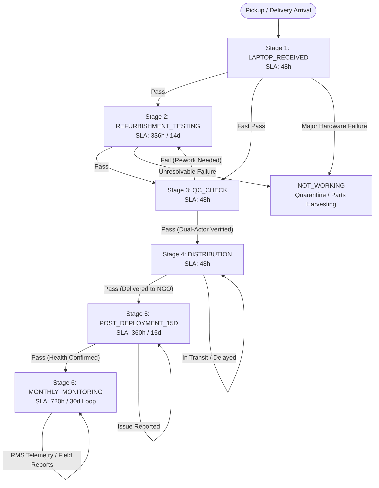

# Sama Platform — End-to-End Stages & Lifecycle Workflow Guide
> **Comprehensive Knowledge Transfer (KT) & Architecture Reference**  
> *Last Verified Against Live Codebase & RDS Schema: November 2026*

---

## Table of Contents
1. [Executive Summary & Lifecycle Architecture](#1-executive-summary--lifecycle-architecture)
2. [Canonical 6-Stage + Quarantine Lifecycle Model](#2-canonical-6-stage--quarantine-lifecycle-model)
3. [Stage-by-Stage Operational & Technical Breakdown](#3-stage-by-stage-operational--technical-breakdown)
   - [Stage 1: LAPTOP_RECEIVED (Intake & Registration)](#stage-1-laptop_received-intake--registration)
   - [Stage 2: REFURBISHMENT_TESTING (Hardware & Software Refurbishment)](#stage-2-refurbishment_testing-hardware--software-refurbishment)
   - [Stage 3: QC_CHECK (Independent Quality Verification)](#stage-3-qc_check-independent-quality-verification)
   - [Stage 4: DISTRIBUTION (Allocation & Dispatch)](#stage-4-distribution-allocation--dispatch)
   - [Stage 5: POST_DEPLOYMENT_15D (15-Day Field Follow-Up)](#stage-5-post_deployment_15d-15-day-field-follow-up)
   - [Stage 6: MONTHLY_MONITORING (Continuous Impact & Health Tracking)](#stage-6-monthly_monitoring-continuous-impact--health-tracking)
   - [Quarantine Stage: NOT_WORKING](#quarantine-stage-not_working)
4. [Database Architecture & Schema (`sama_ops`)](#4-database-architecture--schema-sama_ops)
5. [Backend Execution Engine & API Contracts](#5-backend-execution-engine--api-contracts)
6. [Frontend UI Architecture & Operator Experience](#6-frontend-ui-architecture--operator-experience)
7. [RMS (Remote Monitoring System) & Telemetry Integration](#7-rms-remote-monitoring-system--telemetry-integration)
8. [Roles, Permissions & Dual-Actor Enforcement](#8-roles-permissions--dual-actor-enforcement)
9. [Operator Cheat Sheet & Common Edge Cases](#9-operator-cheat-sheet--common-edge-cases)

---

## 1. Executive Summary & Lifecycle Architecture

The **Sama Laptop Lifecycle Engine** governs the progression of every donated device from arrival at the refurbishment center to active digital education in the field.

### Key Architectural Tenets
1. **Strict Stage Gating:** A laptop can never jump stages arbitrarily. Forward progression requires an active **Stage Run** evaluated against deterministic gate rules and checklists.
2. **Dual-Actor Integrity:** Critical quality gates (notably **QC_CHECK**) strictly enforce `requires_different_actor = TRUE`. The technician who refurbished the device cannot approve their own QC check.
3. **Immutable Audit Trail:** All state transitions, checklist responses, photos, and gate evaluations are stored in append-only tables (`laptop_stage_run`, `checklist_response`, `stage_gate_evaluation`, and `audit_for_laptops`).
4. **Failure Branching:** Devices failing essential hardware criteria branch into `NOT_WORKING` or loop back into refurbishment for rework without corrupting the operational pipeline.



---

## 2. Canonical 6-Stage + Quarantine Lifecycle Model

Active stages in PostgreSQL table `sama_ops.stage_definition` and backend vocabulary (`backend/app/domain/laptops/vocabulary.py`):

| Stage ID | Stage Code | Display Name | Order | SLA | Responsible Role | Verifier Role | Requires Dual Actor? |
| :---: | :--- | :--- | :---: | :---: | :--- | :--- | :---: |
| **1** | `LAPTOP_RECEIVED` | Laptop Received | 1 | 48 hrs | Intake Staff | Intake Supervisor | No |
| **2** | `REFURBISHMENT_TESTING` | Refurbishment and Testing | 2 | 336 hrs (14d) | Refurbisher | QC Technician | No |
| **3** | `QC_CHECK` | QC Check | 3 | 48 hrs | QC Technician | QC Supervisor | **YES** |
| **4** | `DISTRIBUTION` | Distribution | 4 | 48 hrs | Dispatch Coordinator | Dispatch Supervisor | No |
| **5** | `POST_DEPLOYMENT_15D` | Post-Deployment (15-day) | 5 | 360 hrs (15d) | Programme Coordinator | Programme Manager | No |
| **6** | `MONTHLY_MONITORING` | Monthly Monitoring | 6 | 720 hrs (30d) | Programme Coordinator | Programme Manager | No |
| **7** | `NOT_WORKING` | Not Working (Quarantine) | 7 | 0 hrs | Intake Staff | Intake Supervisor | No |

---

## 3. Stage-by-Stage Operational & Technical Breakdown

---

### Stage 1: LAPTOP_RECEIVED (Intake & Registration)
* **Goal:** Acknowledge receipt of physical devices, sanitize assets, eliminate duplicates, grade cosmetics, and assign a unique barcode.
* **SLA:** 48 hours from physical dock arrival.
* **Key Checklist Sections:**
  1. `RECEIPT_DOCS`: Serial number recorded, donor company verified, hardware specs (RAM, Storage, CPU, Model) captured.
  2. `RECEIPT_PHYSICAL`: Exterior inspection, hinge/bezel integrity, ports and adapter testing.
  3. `RECEIPT_TAGGING`: Unique barcode label affixed and scanned, inventory shelf location assigned.
* **Gate Rules (`stage_gate_rule`):**
  * `S1_REQUIRED_FIELDS`: Device must have serial number (`id`), donor, and `inventory_location`.
  * `S1_SERIAL_VERIFIED`: Must not be duplicate or blacklisted.
  * `S1_EVIDENCE_ATTACHED`: Photo evidence uploaded if physical damage is noted.
* **Transitions:**
  * `PASS` → `REFURBISHMENT_TESTING`
  * `FAIL` → `NOT_WORKING`
  * `FAST_PASS` → `QC_CHECK` (Available for pristine, verified corporate fleets requiring zero hardware repairs).

---

### Stage 2: REFURBISHMENT_TESTING (Hardware & Software Refurbishment)
* **Goal:** Restore physical hardware to full functionality, clean internals, execute certified NIST 800-88 data sanitization, install clean OS, drivers, antivirus, and register RMS remote telemetry.
* **SLA:** 336 hours (14 calendar days).
* **Key Checklist Sections:**
  1. `REFURB_HW_CLEAN`: Internal dust removal, fan cleaning, thermal paste re-application, keyboard sanitization.
  2. `REFURB_TESTING`: Power-on stress test, keyboard all-key test, battery capacity measurement (≥ 70% threshold), port loopback tests, camera & microphone test.
  3. `REFURB_SOFTWARE`: Clean OS installation/reset, Windows activation, drivers update, antivirus deployment, local admin password setting, and RMS monitoring agent enrollment (`RMS_INSTALLED_ACTIVE`).
* **Gate Rules:**
  * `S2_MANDATORY_ITEMS`: All 5 functional hardware tests must pass (`POWER_TEST_DONE`, `INPUT_TEST_DONE`, `BATTERY_TEST_DONE`, `PORT_TEST_DONE`, `CAMERA_AUDIO_TEST_DONE`).
  * `S2_RMS_VERIFIED`: RMS telemetry agent active or verified.
* **Transitions:**
  * `PASS` → `QC_CHECK`
  * `FAIL` → `NOT_WORKING`

---

### Stage 3: QC_CHECK (Independent Quality Verification)
* **Goal:** A secondary, independent quality audit to certify the device is 100% field-ready.
* **SLA:** 48 hours.
* **Crucial Rule — Dual-Actor Enforcement:**
  * `requires_different_actor = TRUE`.
  * The person executing `QC_CHECK` **cannot** be the technician who completed `REFURBISHMENT_TESTING`. The backend rejects self-approval with HTTP 400 (`"Different actor required for stage verification"`).
* **Key Checklist Sections:**
  1. `QC_REVERIFY`: Independent verification of display (no dead pixels or backlight bleed), keyboard, touchpad, audio, WiFi connectivity, battery health, and cosmetic grade confirmation.
  2. `QC_SECURITY`: Windows Firewall active, antivirus definitions up-to-date, storage encryption/data wiping certificate verified.
  3. `QC_PACKAGING`: Clean device packaging, matching power adapter & cable included, serial barcode label readable.
* **Gate Rules:**
  * `S3_INDEPENDENT_VERIFICATION`: Dual-actor validation rule.
  * `S3_ALL_P1_PASS`: Zero P1 defects permitted.
* **Transitions:**
  * `PASS` → `DISTRIBUTION`
  * `FAIL` → Loops back to `QC_CHECK` or `REFURBISHMENT_TESTING` for technician rework.

---

### Stage 4: DISTRIBUTION (Allocation & Dispatch)
* **Goal:** Match approved devices with registered NGO partner requirements (`external_registered_ngo`), generate dispatch manifests, and ship devices.
* **SLA:** 48 hours from allocation.
* **Key Checklist Sections:**
  1. `DIST_ALLOCATION`: Partner allocation matched (`allocated_to`), student/learner cohort assigned.
  2. `DIST_DISPATCH`: Courier / transport manifest generated, dispatch date and tracking number logged in dashboard.
  3. `DIST_HANDOVER`: Partner receiving acknowledgment uploaded upon delivery (`last_delivery_date`).
* **Transitions:**
  * `PASS` → `POST_DEPLOYMENT_15D`
  * `FAIL` → Remains in `DISTRIBUTION` until shipping resolution.

---

### Stage 5: POST_DEPLOYMENT_15D (15-Day Field Follow-Up)
* **Goal:** Confirm the laptop arrived safely, is unboxed, connected to the internet, and actively used by the designated student or community centre.
* **SLA:** 360 hours (15 days post-delivery).
* **Key Activities:**
  1. Programme coordinator contacts NGO point-of-contact.
  2. Verify initial RMS heartbeat (first online connection timestamp logged).
  3. Log user onboarding feedback or immediate technical issues in `sama_ops.monthly_check_in`.
* **Transitions:**
  * `PASS` → `MONTHLY_MONITORING`
  * `FAIL` / `ISSUE` → Logs entry in `sama_ops.issue_log` (P1/P2/P3) and initiates field resolution.

---

### Stage 6: MONTHLY_MONITORING (Continuous Impact & Health Tracking)
* **Goal:** Ongoing recurring operational telemetry, student attendance, curriculum usage hours, and hardware maintenance tracking.
* **Cadence:** Recurring monthly (SLA: 720 hours / 30-day loop).
* **Key Metrics Logged:**
  * Remote device heartbeat from RMS daemon (`rms_last_seen`).
  * Weekly usage hours (tracked via telemetry or coordinator check-in).
  * Impact updates: Modules completed, student attendance, employment outcomes.
* **Failure / Flag Trigger:**
  * If a device ceases reporting to RMS for > 30 days, an automatic Inactivity Alert is dispatched to `operations@thesama.in` and flagged on the RMS dashboard.

---

### Quarantine Stage: NOT_WORKING
* **Purpose:** Devices with irreparable motherboard failure, broken chassis, or non-viable battery/screen economics.
* **Workflows:**
  1. Component harvesting (salvage functional RAM, SSD, keyboards, screens for other refurbishment units).
  2. Certified R2 / e-waste recycling disposal with legal documentation.

---

## 4. Database Architecture & Schema (`sama_ops`)

```
   ┌────────────────────────────────────────────────────────┐
   │                  sama_ops.laptop_labeling              │
   │  id (PK) · status · condition_status · allocated_to    │
   │  last_delivery_date · refurbishment_date · rms_status  │
   └───────────────────────────┬────────────────────────────┘
                               │ 1:N
                               ▼
   ┌────────────────────────────────────────────────────────┐
   │                sama_ops.laptop_stage_run               │
   │  run_id (PK) · laptop_id (FK) · stage_id (FK)          │
   │  stage_code · run_number · outcome · started_by       │
   │  completed_by · verifier_name · completed_at           │
   └─────────────┬────────────────────────────┬─────────────┘
                 │ 1:N                        │ 1:N
                 ▼                            ▼
   ┌───────────────────────────┐ ┌──────────────────────────┐
   │ sama_ops.checklist_response│ │sama_ops.stage_gate_eval  │
   │ response_id (PK)          │ │ eval_id (PK)             │
   │ run_id (FK)               │ │ run_id (FK)              │
   │ item_id (FK)              │ │ rule_code · outcome      │
   │ result ('PASS'/'FAIL')    │ │ is_blocking · evaluated_at│
   │ evidence_url              │ └──────────────────────────┘
   └───────────────────────────┘
```

### Table Dictionary

| Table Name | Description | Key Columns |
| :--- | :--- | :--- |
| `stage_definition` | Master registry of all stages | `stage_id`, `stage_code`, `stage_name`, `sla_hours`, `requires_different_actor`, `is_active` |
| `checklist_section` | Logical groupings within a stage | `section_id`, `stage_code`, `section_name`, `display_order` |
| `checklist_item` | Granular check items (~145 total) | `item_id`, `section_id`, `item_code`, `item_text`, `is_mandatory`, `evidence_required`, `severity_if_fail` |
| `laptop_stage_run` | Execution instance for a device | `run_id`, `laptop_id`, `stage_id`, `run_number`, `outcome`, `started_by`, `completed_by`, `verifier_name` |
| `checklist_response`| Operator response per item | `response_id`, `run_id`, `item_id`, `result` (`PASS`/`FAIL`/`NA`), `evidence_url`, `remark` |
| `stage_gate_rule` | Validation logic required to pass | `rule_id`, `stage_code`, `rule_code`, `is_blocking`, `config_json` |
| `stage_gate_evaluation` | Logged evaluation pass/fail | `eval_id`, `run_id`, `rule_code`, `outcome`, `failure_reason` |
| `issue_log` | Hardware or field issue tickets | `issue_id`, `laptop_id`, `severity` (`P1`/`P2`/`P3`), `status` (`OPEN`/`RESOLVED`), `reported_by` |
| `monthly_check_in` | 15-day and monthly monitoring log | `checkin_id`, `laptop_id`, `checkin_date`, `active_users_count`, `rms_status`, `rms_last_seen` |

---

## 5. Backend Execution Engine & API Contracts

All stage calls are routed through `backend/app/domain/laptops/stages.py` via FastAPI endpoints.

### Lifecycle Method Flow
1. **`startStageRun`**
   * Creates a new row in `laptop_stage_run` with `outcome = 'IN_PROGRESS'`.
   * Increments `run_number` for that device and stage.
   * Logs `started_by` and `started_at = NOW()`.
2. **`submitChecklistResponses`**
   * Upserts rows into `checklist_response` for the given `run_id`.
   * Accepts `result` (`PASS`, `FAIL`, `NA`), text `remark`, and optional S3 `evidence_url`.
3. **`evaluateStageRun`**
   * Evaluates all active `stage_gate_rule` rows for that stage.
   * Checks mandatory items, P1 failure presence, dashboard field completeness, and dual-actor requirement.
   * Writes results to `stage_gate_evaluation`.
   * Returns `{ "overall_outcome": "PASS" | "FAIL", "evaluations": [...] }`.
4. **`completeStageRun`**
   * Invokes gate evaluation.
   * If any blocking gate fails, run outcome is marked `FAIL` and status changes according to failure transitions (e.g., `NOT_WORKING` or loopback).
   * If all blocking gates pass:
     * Sets `laptop_stage_run.outcome = 'PASS'`.
     * Resolves the next target stage from `STAGE_TRANSITIONS` (e.g. `LAPTOP_RECEIVED` → `REFURBISHMENT_TESTING`).
     * Updates `laptop_labeling.status` to the new stage code.
     * Appends an entry to `audit_for_laptops`.

---

## 6. Frontend UI Architecture & Operator Experience

### Primary Stage Components
* **`LaptopStageDetails.js`** (`src/Pages/LaptopTagging/`):
  * Displays the visual timeline for an individual laptop.
  * Shows all historical runs, verifiers, dates, and previous gate evaluations.
  * Renders action buttons to start or complete runs.
* **`StageRunModal.js`** (`src/Pages/LaptopTagging/`):
  * The primary workspace modal used by workshop technicians and QC engineers.
  * Dynamically renders sections and items from `getStageTemplate`.
  * Integrates **`WebcamCaptureModal.js`** to capture real-time webcam photos of laptops, auto-uploading them to AWS S3 (`sama-ops` bucket) for immediate evidence attachment.

---

## 7. RMS (Remote Monitoring System) & Telemetry Integration

* **Agent Deployment:** During Stage 2 (`REFURBISHMENT_TESTING`), technicians install the lightweight RMS background daemon.
* **Telemetry Endpoints (`backend/app/api/routes/rms.py`):**
  * `POST /api/rms-webhook`: Receives automated pings from devices containing `asset_tag` and connectivity status.
  * Updates `laptop_labeling.rms_status` and `last_active_date = CURRENT_TIMESTAMP`.
* **Automated Inactivity Alert:**
  * If status reports `INACTIVE` (> 30 days without network connection), an automatic notification is dispatched to Ops.

---

## 8. Roles, Permissions & Dual-Actor Enforcement

| User Role | Permissions Across Stages |
| :--- | :--- |
| **Intake Staff** | Can start, execute, and complete Stage 1 (`LAPTOP_RECEIVED`) |
| **Refurbisher** | Can start and complete Stage 2 (`REFURBISHMENT_TESTING`) |
| **QC Technician** | Can run Stage 3 (`QC_CHECK`). **Blocked from verifying laptops they personally refurbished.** |
| **Dispatch Coordinator** | Can execute Stage 4 (`DISTRIBUTION`) |
| **Programme Coordinator** | Can execute Stage 5 (`POST_DEPLOYMENT_15D`) & Stage 6 (`MONTHLY_MONITORING`) |
| **Admin / Ops Lead** | Super-verifier privileges; can inspect all gate evaluations, reopen failed runs, and view raw audit trails |

---

## 9. Operator Cheat Sheet & Common Edge Cases

### Common Issues & Immediate Resolutions
1. **"Different actor required for stage verification" Error on QC:**
   * *Cause:* The logged-in user who clicked "Complete Run" on `QC_CHECK` is identical to the `completed_by` user from `REFURBISHMENT_TESTING`.
   * *Fix:* A different verified QC officer must log in to inspect and sign off on the QC run.
2. **Laptop Blocked with Gate Failures:**
   * *Cause:* A mandatory checklist item has been marked `FAIL` or has missing photo evidence.
   * *Fix:* Open the active run in `StageRunModal`, fix the hardware defect or re-upload photo evidence, re-evaluate, and complete.
3. **Accidental Quarantine to `NOT_WORKING`:**
   * *Fix:* Start a new stage run from the detail page, perform diagnostic verification, pass all checklist items, and complete the run to graduate the device back to the active pipeline.
